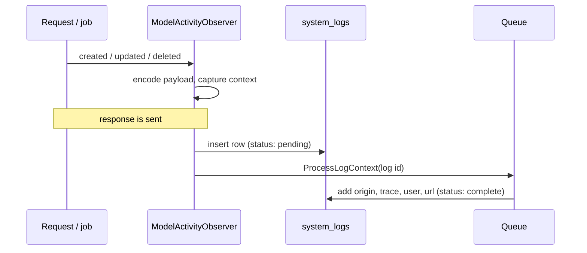

# Laravel System Log

[](https://github.com/viicslen/laravel-system-log/actions/workflows/ci.yml)


Logs every create, update and delete of your Eloquent models, without slowing the request that made them.

- **Off the hot path.** The row is written with `defer()` after the response is sent. A small queued job then adds who did it, from where, and the call stack.
- **Small rows.** Diff mode stores only what changed: long text as a reverse patch, JSON as the keys that changed, and nothing for columns you exclude.
- **Full history anyway.** Any past state of a model can be rebuilt from its live row and its log, so you don't need a snapshot on every row.
- **Bounded growth.** Prune old rows by age, or merge them into one row per model per month and keep the history forever.

## Contents

- [How it works](#how-it-works)
- [Installation](#installation)
- [Usage](#usage)
- [Diff mode](#diff-mode)
- [Keeping the table small](#keeping-the-table-small)
- [Multi-tenant apps](#multi-tenant-apps)
- [Configuration](#configuration)
- [Upgrading](#upgrading)
- [Development](#development)

## How it works



The whole payload goes into the database row. Only the row id and a small context object go through the queue, so messages stay far below queue size limits such as SQS's 256 KB.

## Installation

```bash
composer require viicslen/laravel-system-log
php artisan system-log:install   # publishes the config and migrations, offers to migrate
```

Or publish them yourself:

```bash
php artisan vendor:publish --tag=system-log-config
php artisan vendor:publish --tag=system-log-migrations
php artisan migrate
```

## Usage

Add the trait to any model you want logged:

```php
use ViicSlen\SystemLog\Concerns\HasSystemLogs;

class Order extends Model
{
    use HasSystemLogs;
}
```

That's it. Every `created`, `updated` and `deleted` event now writes a row. A save that changes nothing writes no row.

```php
$order->systemLogs()->latest()->get();             // the order's log rows

SystemLog::query()->forModel($order)->count();     // the same, from the log side
SystemLog::query()->pending()->get();              // rows still waiting for their context
SystemLog::query()->failed()->get();               // rows whose context job gave up
```

Each row holds:

| Column | What's in it |
| --- | --- |
| `event` | `created`, `updated`, `deleted`, or `compacted` for a merged month |
| `attributes` | A full snapshot (created, deleted, or every update in `full` mode) |
| `modified` / `original` | The changed columns after and before the change |
| `user_id`, `origin`, `trace`, `metadata` | Who made the change, from where (`web`, `cli`, `job`), the call stack, and request data |
| `status` | `pending` → `complete`, or `failed` after 3 tries |

### Rebuilding a past state

```php
$order->systemLogStateAt(now()->subMonth());   // raw attributes as of a time
$order->systemLogStateAt($log);                // right after a given log row
$log->rebuiltAttributes();                     // the same, from the row

use ViicSlen\SystemLog\Support\History;

foreach (History::walk($order->getMorphClass(), $order->getKey()) as [$log, $after, $before]) {
    // each row newest first, with the attributes right after it and right before it
}
```

The walk starts from the live row and undoes each log row in turn, reading 500 rows per query, so memory doesn't grow with the length of the history. A value the log can no longer rebuild is left out of the state rather than guessed.

## Diff mode

`full` mode (the default) stores a whole snapshot on every update. `diff` mode stores only the change, which makes rows far smaller:

```php
// config/system-log.php
'payload' => [
    'mode' => 'diff',
    'snapshot_every' => 0,      // > 0: also keep a full snapshot when none of the last N - 1 rows has one
],

'attributes' => [
    'max_value_length' => 1000, // values longer than this go through a strategy
    'strategy' => 'truncate',
    'columns' => [
        'description' => 'patch',  // reverse line patch
        'settings' => 'json',      // only the top-level keys that changed
    ],
],

'exclude' => ['view_count'],     // an update touching only these writes no row
```

| Strategy | Stores | Can rebuild the old value |
| --- | --- | --- |
| `truncate` | The value cut at `max_value_length` | No |
| `omit` | A marker that the value changed | No |
| `json` | The keys that changed, on each side | Yes |
| `patch` | A patch from the new value back to the old one | Yes |

## Keeping the table small

**Prune by age** with Laravel's own `model:prune`:

```php
'prune' => ['enabled' => true, 'retention_days' => 60],
```

```bash
php artisan model:prune --model="ViicSlen\SystemLog\Models\SystemLog"
```

**Or compact** to keep the history forever at about one row per model per month once it is old. Rows older than `after_days` are merged into one `compacted` row per model per month. The merged row's change is worked out again from the states at the start and end of the month, so rebuilding past it still lands on the exact start-of-month state.

```php
'compaction' => ['enabled' => true, 'after_days' => 60],
```

```bash
php artisan system-log:compact                      # every model with compaction on
php artisan system-log:compact --model="App\Models\Listing" --chunk=500
```

A model with compaction on is never pruned by age. Run the command daily from a scheduler that never starts a second run while one is still going. It skips any model changed in the last 10 minutes, and an interrupted run carries on where it stopped the next time.

### Per-model settings

Any of the settings above can be overridden for one model:

```php
'models' => [
    App\Models\Listing::class => [
        'payload' => ['mode' => 'diff', 'snapshot_every' => 25],
        'exclude' => ['watch_count'],
        'attributes' => ['columns' => ['description' => 'patch', 'data' => 'json']],
        'compaction' => ['enabled' => true],
        'prune' => ['enabled' => false],
    ],
],
```

## Multi-tenant apps

The row is written after the response, when state such as an active tenant connection may already be gone. Implement `ScopeBridge` to capture that state while it is still active and restore it around the write:

```php
use ViicSlen\SystemLog\Contracts\ScopeBridge;

class TenancyScopeBridge implements ScopeBridge
{
    public function capture(): mixed
    {
        return tenancy()->initialized ? tenant()->getTenantKey() : null;
    }

    public function restore(mixed $scope, Closure $callback): void
    {
        if ($scope === null) {
            $callback();   // no tenant was active: write on the current connection

            return;
        }

        // A tenant deleted in the meantime: drop the row rather than write it centrally.
        tenancy()->find($scope)?->run($callback);
    }
}
```

```php
'scope' => TenancyScopeBridge::class,   // or SYSTEM_LOG_SCOPE
```

## Configuration

| Key | Env | Default | |
| --- | --- | --- | --- |
| `enabled` | `SYSTEM_LOG_ENABLED` | `true` | Turns logging off entirely |
| `database.connection` | `SYSTEM_LOG_CONNECTION` | app default | Write logs to a separate database |
| `database.table` | `SYSTEM_LOG_TABLE` | `system_logs` | |
| `database.model` | | `SystemLog::class` | Swap in your own model |
| `database.foreign_key_type` | `SYSTEM_LOG_ID_TYPE` | `string` | `string` (UUID-safe) or `bigInteger` |
| `payload.mode` | `SYSTEM_LOG_PAYLOAD_MODE` | `full` | `full` or `diff` |
| `payload.snapshot_created` / `snapshot_deleted` | | `true` | Snapshot created / deleted rows in diff mode |
| `payload.snapshot_every` | `SYSTEM_LOG_SNAPSHOT_EVERY` | `0` | See [Diff mode](#diff-mode) |
| `exclude` | | `[]` | Columns never logged |
| `attributes.max_value_length` | `SYSTEM_LOG_MAX_VALUE_LENGTH` | `1000` | |
| `attributes.strategy` / `columns` / `casts` | | `truncate` | Long-value strategy, globally, per column, per cast |
| `compaction.enabled` / `after_days` | | `false` / `60` | |
| `prune.enabled` / `retention_days` | `SYSTEM_LOG_RETENTION_DAYS` | `true` / `60` | |
| `models` | | `[]` | Per-model overrides |
| `scope` | `SYSTEM_LOG_SCOPE` | `null` | A `ScopeBridge` class |
| `queue.connection` / `name` | `SYSTEM_LOG_QUEUE_CONNECTION` / `SYSTEM_LOG_QUEUE` | app default / `default` | Where the context job runs |
| `backtrace.max_frames` | | `10` | Stack frames kept per row |
| `backtrace.skip_paths` / `include_paths` | | `vendor/`, `artisan` | Glob patterns for frames to drop, and frames to keep anyway |
| `input_except` | | `password`, … | Request keys never stored |

## Upgrading

Two migrations were added after the first release. Publish and run them before deploying the version that uses them:

- `add_changed_at_micros_to_system_logs_table` adds a nullable column that orders writes landing in the same second. It must run before the code that writes it.
- `add_type_time_index_to_system_logs_table` adds a (`loggable_type`, `created_at`) index, so pruning one type no longer scans the others. Building it on a large table needs temporary disk space.

```bash
php artisan vendor:publish --tag=system-log-migrations
php artisan migrate
```

## Development

```bash
composer install
composer format   # Laravel Pint
composer test     # Pest
```

CI runs the style check and the tests on PHP 8.3 and 8.4. See [AGENTS.md](AGENTS.md) for the architecture notes.

## License

MIT
